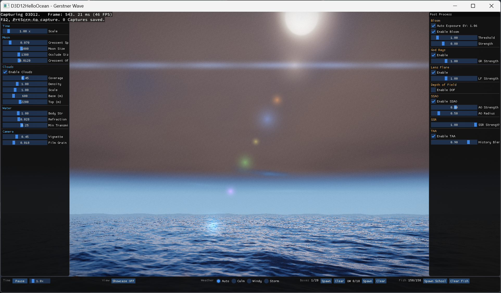
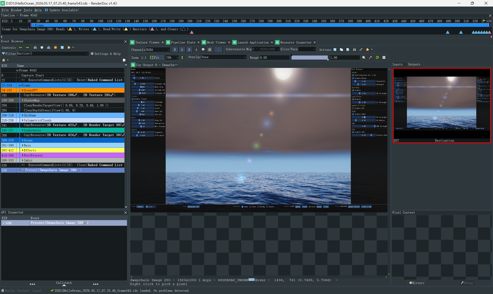

# D3D12 Hello Ocean

**日本語** | [English](README.en.md)

DirectX 12 と C++20 でゼロから構築したリアルタイム海洋レンダラーです。JONSWAP スペクトルに基づく高速フーリエ変換（FFT）により海面をすべて GPU 上でシミュレーションし、Gerstner 波、ボリュメトリッククラウド、ポストプロセスパイプライン、動的な天候システムを組み合わせています。

> **デモ動画：** <https://youtu.be/7AlJAtE4OF4>  
> **ビルド環境：** Visual Studio 2022 · DirectX 12 · C++20 · Windows 10/11

---

## スクリーンショット





---

## 技術的なポイント

| 機能 | 内容 |
|---|---|
| 海洋シミュレーション | GPU FFT（JONSWAP スペクトル + Cooley-Tukey Radix-2 IFFT） |
| 海面メッシュ | 無限タイル海面（9×9 タイル、1 タイル 400 m）、フラスタムカリング、2 段階 LOD |
| 波モデル | FFT 変位マップ + Gerstner 波 4 本 |
| ボリュメトリッククラウド | レイマーチング、Henyey-Greenstein 位相関数、Beer-Lambert 減衰、半解像度レンダリング |
| 雲の影 | 各サーフェスから太陽方向へレイマーチ — 雲の切れ間が海面に明るい模様を落とす |
| 空 | プロシージャルなグラデーション、太陽・月の円盤、三日月の満ち欠け、プロシージャルな星空 |
| ポストプロセス | TAA · Bloom · God Rays · DOF · SSAO · SSR · Lens Flare · ACES トーンマッピング |
| 水面シェーディング | Beer-Lambert 吸収 · コースティクス · 屈折 · フレネル · SSS |
| 水中表現 | スネルの窓（臨界角 ≈ 48.6°）、全反射 |
| レンダーターゲット | HDR（R16G16B16A16_FLOAT）→ LDR（R8G8B8A8_UNORM） |

---

## 海洋シミュレーションのパイプライン

シミュレーションは毎フレーム、3 つのコンピュートシェーダーパスを順番に実行します。

```
[起動時]
PhillipsCS.hlsl      — JONSWAP モデルから初期スペクトル H₀(k) を生成

[毎フレーム]
TimeEvolutionCS.hlsl — 分散関係 ω(k) = √(g|k|) でスペクトルを時間発展
IFFTCS.hlsl          — X 軸 → Y 軸の順にピンポン方式の Radix-2 IFFT → 空間の高さマップ
```

得られた変位テクスチャを頂点シェーダーでサンプリングします。法線は差分法で求め、正確な Phong ライティングとフレネル反射に使用しています。

---

## ボリュメトリッククラウド

雲は専用のフルスクリーンパスで、水平な層（高度 600 – 2200 m）の中をレイマーチングして描画します。

### パフォーマンス — 半解像度レンダリング

1920×1080 のフル解像度でレイマーチングすると、空を見上げたときに約 22 fps まで落ち込んでいました。以下の最適化を組み合わせ、全体で **約 8 倍の高速化** を実現しました。

| 最適化 | 内容 |
|---|---|
| 半解像度 RT | 雲を 960×540（ピクセル数 ¼）で描画し、4 タップのテントフィルターでアップサンプリング |
| ステップ数 64 → 32 | メインのマーチングの反復コストを半減 |
| 薄い雲のライトマーチを省略 | 密度 < 0.04 の場合、5 ステップのシャドウレイの代わりに固定透過率 0.85 を使用 |

雲は低周波な内容なので、バイリニアアップサンプリングによる画質の低下はほとんどありません。

### アーティファクトの修正 — Gradient Noise（Perlin 系）

初期バージョンでは **Value Noise** を使用していました。これは格子の各頂点にスカラー値を持たせて補間する方式で、等値面が格子に沿った弧になるため、特に雲量が少ないときに **指紋や等高線のような模様** が発生していました。

```
Value Noise の等値面:            Gradient Noise の等値面:

  · · · · ·                        · · · · ·
  · ╭───╮ ·  ← 格子に沿った弧     · ╭──╮  ·  ← 自然な曲線
  · │   │ ·    → 指紋状の輪       ·  ╰──╯  ·    格子に揃わない
  · ╰───╯ ·                        · · · · ·
  · · · · ·
```

**修正：** **Gradient Noise** に置き換えました。各格子点にランダムな勾配 *ベクトル* を持たせ、値を `dot(gradient, offset)` で求めます。等値面は勾配方向に沿った自然な曲線になり、どのしきい値でも指紋状の模様や格子の境界が出なくなりました。

---

## シーンのシステム

### 天候
3 種類のプリセットを、パラメーターを滑らかに補間しながら切り替えます。

| キー | モード | 効果 |
|---|---|---|
| `1` | Calm（穏やか） | 低い波、晴れ |
| `2` | Windy（強風） | FFT の振幅が大きくなり、雲が流れる |
| `3` | Storm（嵐） | 最大の波高、強い雨 |
| `4` | Auto（自動） | 状態を自動で切り替え |

### 雨と波紋
カメラ周囲の円形範囲に最大 **2000 個の雨粒パーティクル** を生成し、最大 **200 個の水面の波紋** を広がるリングとして描画します。

### 魚群
CPU 側の **Boids による群れのシミュレーション**（分離・整列・結合）で、最大約 150 匹の魚を GPU インスタンシングで描画します。

### 浮遊オブジェクト
FFT 変位マップから直接サンプリングした箱が、正しい高さと傾きで波に揺られます。水中のオブジェクトには Beer-Lambert のフォグを適用しています。

### ショーケースモード（`V`）
サイン波の揺れで自然な上下動を加えた自動カメラデモです。映像の録画に使用しています。

---

## ポストプロセスパイプライン

```
HDR シーン
  └─ ボリュメトリッククラウド（半解像度レイマーチ + 合成）
  └─ SSAO
  └─ スクリーンスペース反射（SSR）
  └─ God Rays（太陽方向への 64 サンプル放射ブラー）
  └─ Bloom（輝度しきい値 + ガウシアンブラー）
  └─ Lens Flare
  └─ 被写界深度（DOF）
  └─ ACES トーンマッピング
  └─ TAA（Halton ジッター + 履歴ブレンド）
  └─ LDR 出力
```

---

## 操作方法

| 入力 | 操作 |
|---|---|
| `W / A / S / D` | カメラ移動 |
| マウスドラッグ | カメラ回転 |
| `V` | ショーケース（自動飛行）モード切り替え |
| `Tab` | ワイヤーフレーム切り替え |
| ImGui パネル（左） | 月・雲・水・カメラのパラメーター |
| ImGui パネル（右） | ポストプロセス：Bloom、DoF、SSAO、SSR、TAA など |
| ImGui バー（下） | タイムスケール、天候、生成の操作 |

---

## ビルド方法

**必要環境**
- Windows 10 / 11（x64）
- Visual Studio 2022（「C++ によるデスクトップ開発」ワークロード）
- 以下の NuGet パッケージは初回ビルド時に自動で復元されます
  - `Microsoft.Direct3D.D3D12`（Agility SDK）
  - `Microsoft.Direct3D.DXC`

**手順**
1. リポジトリをクローンする
2. Visual Studio 2022 で `D3D12HelloWorld.sln` を開く
3. ビルド → ソリューションのビルド（`Ctrl+Shift+B`）
4. `HelloTriangle/bin/x64/Debug/` の実行ファイルを起動する

---

## プロジェクト構成

```
HelloTriangle/
├── Main.cpp                      エントリーポイント（WinMain）
├── D3D12HelloTriangle.h/cpp      アプリケーションクラス、DX12 デバイスの初期化
└── source/
    ├── OceanFFT.h/cpp            FFT シミュレーション（JONSWAP、時間発展、IFFT）
    ├── Renderer.h/cpp            無限タイル海面メッシュ、描画コール、雲の影の定数バッファ
    ├── SkyDome.h/cpp             プロシージャルな空、太陽・月のサイクル、昼夜
    ├── VolumetricClouds.h/cpp    レイマーチングの雲（半解像度 RT、Gradient Noise）
    ├── WeatherSystem.h/cpp       天候のステートマシン
    ├── RainSystem.h/cpp          雨のパーティクル（円形生成）+ 波紋
    ├── FishSchool.h/cpp          Boids + GPU インスタンシング
    ├── FloatingObject.h/cpp      波に浮かぶオブジェクト
    └── PostProcessPipeline.h/cpp ポストプロセスチェーン全体

shaders/
├── PhillipsCS.hlsl               スペクトルの初期化（コンピュート）
├── TimeEvolutionCS.hlsl          毎フレームのスペクトル更新（コンピュート）
├── IFFTCS.hlsl                   逆 FFT（コンピュート）
├── shaders.hlsl                  海面の VS/PS + 雲の影のレイマーチ
├── clouds.hlsl                   ボリュメトリッククラウドのレイマーチ + 合成
├── skyShaders.hlsl               スカイドームの VS/PS
└── ...                           ポストプロセス用シェーダー（bloom、godrays、taa など）
```

---

## 更新履歴

| 日付 | 内容 |
|---|---|
| 2026-06-29 | **雲の影のちらつき修正** — 6 ステップの FBM レイマーチを、雲層の中間高度への投影点での低周波（`cs_vnoise`）1 回の参照に置き換え。高速で周回する太陽がサンプル点を高周波ノイズ上で動かすことで生じていた、数 Hz の明るさのちらつきを解消（海面と船体の両方のシェーダーに適用） |
| 2026-06-29 | **船の傾き物理の調整** — サンプル距離を 20 m から 35 m に広げ、船体の長さをより正確に反映して短波長の波を平均化。ばねの固有周期を 5 秒から 9 秒（ζ = 0.28）に延ばし、穏やかな海でもより重く慣性のある動きに |
| 2026-06-29 | **船の表示切り替え** — ImGui のチェックボックスで、シーンとは独立して船モデルを表示・非表示。天候だけの映像を録画するときに便利 |
| 2026-06-10 | **ライティングの平滑化と起動時の修正** — SkyDome::SmoothLighting() で、太陽・月の方向、色、強度に 0.5 秒の実時間指数フィルターを適用。空の `m_time` の初期値を昼夜ブレンド帯より下に移し、起動直後の数秒間にスペキュラーハイライトが太陽方向へ移動する問題を修正 |
| 2026-06-10 | **虹エフェクト** — 雨による湿度の蓄積と太陽高度に応じた加算合成のポストプロセスパス（主虹 + 副虹） |
| 2026-06-10 | 船を周回するカメラモード。自動露出を連続的に変化させ、初回フレームのみ即時反映（起動時の明るさのフラッシュを解消）。シャドウマップの太陽方向の修正と船の深度パス |
| 2026-06-09 | **IBL（イメージベースドライティング）** — Split-Sum 近似：キューブマップへの空のキャプチャ、SH9 拡散放射照度、GGX プリフィルタースペキュラー + BRDF LUT を、海面・船・浮遊オブジェクト・魚群に適用。初回フレームでキューブマップの 6 面すべてをキャプチャし、起動時に IBL が暗くなるちらつきを防止 |
| 2026-05-27 | **船の傾き物理** — GPU の FFT 高さのリードバック（CopyTextureRegion、1 フレーム遅延）で駆動する CPU のばね・ダンパー（固有周期 5 秒、ζ = 0.18）。角度のソフトリミットと段階的な復元力 |
| 2026-05-27 | **天候の遷移** — phillipsA / windSpeed を対数空間で補間。Calm/Windy/Storm は 10 秒、Tsunami は 20 秒で遷移。天候ボタンを 2 行に配置 |
| 2026-05-26 | **船の PBR** — Cook-Torrance GGX BRDF、ノーマルマップと ARM（AO/Roughness/Metallic）テクスチャに対応 |
| 2026-05-26 | **津波の天候** — 極端な波のプリセット（windSpeed 160、phillipsA 3.5）、手動切り替え専用 |
| 2026-05-26 | **GLTF の船モデル** — 実行時 GLTF ローダー（cgltf）、複数グループのメッシュ（船体 / 索具 / 帆）、シャドウマップパス |
| 2026-05-17 | **雲の影** — 3 オクターブの FBM を使った各サーフェスから太陽方向へのレイマーチ。指紋状の模様をなくすため Value Noise を Gradient Noise に置き換え。雨システムの修正、UI の全面刷新 |
| 2026-05-15 | **ボリュメトリッククラウド** — 半解像度レイマーチング（8 倍高速化）、Henyey-Greenstein 位相関数、Beer-Lambert 減衰 |
| 2026-05-12 | JONSWAP スペクトルへの移行、フルスクリーン切り替え、1080p 解像度 |
| 2026-05-06 | **魚群** — CPU の Boids（分離 / 整列 / 結合）で駆動する GPU インスタンシング描画。水中の Beer-Lambert フォグ。PostProcessPipeline のリファクタリング |
| 2026-04-29 | 被写界深度、Lens Flare、Bloom、God Rays のポストプロセス |
| 2026-04-28 | ImGui の UI 導入、三日月の描画、昼夜のライティングを滑らかに遷移 |
| 2026-04-22 | FFT 海洋シミュレーション v1.0 — JONSWAP スペクトル + GPU 上の Cooley-Tukey Radix-2 IFFT |
